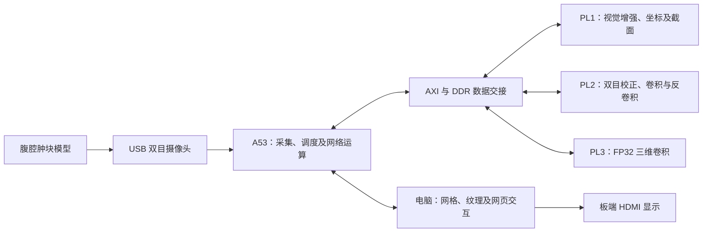

# 系统架构与计算分工

三套完整 PL 配置在同一片 XCZU4EV 上分阶段装载。各套配置的资源占用分别统计。

相机输入为左右拼接的 1280×480 图像。单眼重建输入为 320×360，网络内部高度补齐至 384，执行两次迭代。PL 承担映射到硬件的算子，A53 完成其余网络运算。

PL1 接收 FP32 视差和 FP64 Q 矩阵，使用 FP64 中间运算生成 FP32 毫米坐标。电脑端根据坐标组织网格、附加纹理并提供交互显示。观测坐标与显示补面分别保存。
